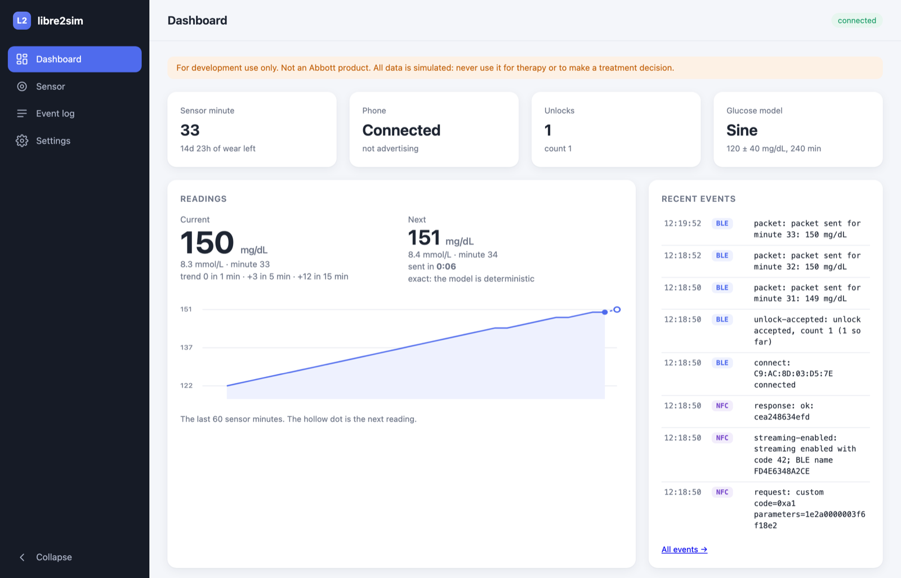
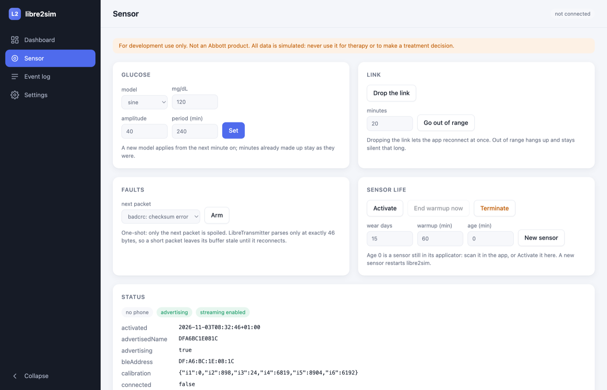
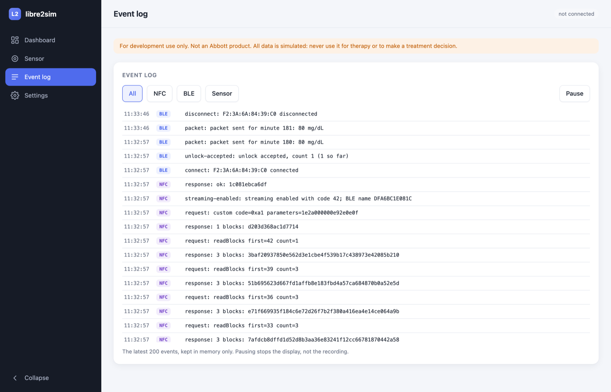
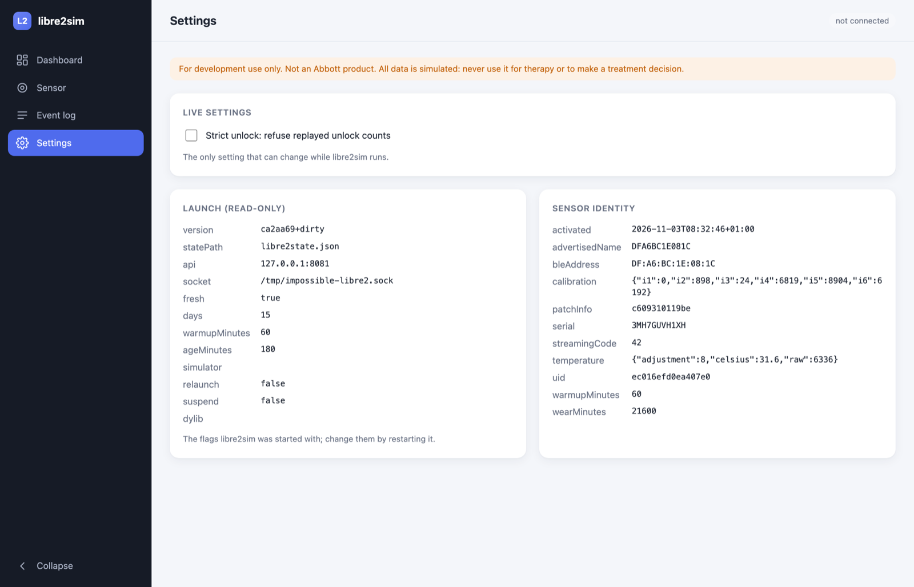
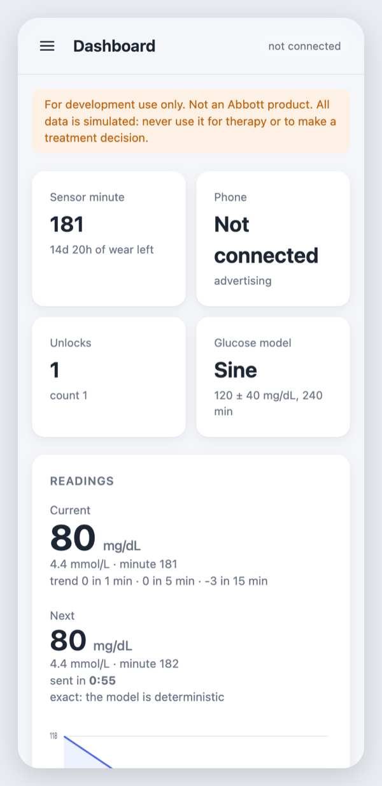
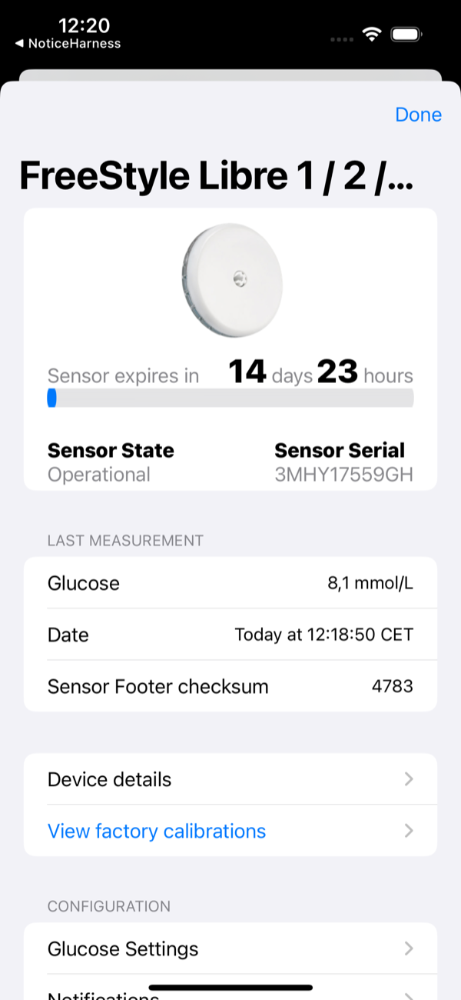

# libre2sim

A FreeStyle Libre 2 Plus (EU) sensor emulator, for exercising
[LibreTransmitter](https://github.com/LoopKit/LibreTransmitter) without a real sensor. It serves an
app in the iOS Simulator through [ImpossiBLE](https://github.com/mickeyl/ImpossiBLE), the same way
[libre3sim](https://github.com/LoopKit/libre3sim) does for the Libre 3 and
[g7sim](https://github.com/LoopKit/g7sim) does for the Dexcom G7.

> **For development use only — not an Abbott product.** libre2sim is an independent, unofficial tool
> for testing CGM software. It is not made, endorsed, or supported by Abbott, it is not a medical
> device, and it emits only simulated, made-up data. "FreeStyle Libre" and "Libre" are trademarks of
> Abbott, used here solely to describe interoperability. Never use it for therapy or any clinical
> decision.

## Quick start

You need a Mac with Xcode and [Go](https://go.dev/dl/) 1.20 or later (`brew install go`).

```bash
git clone https://github.com/dabear/libre2sim && cd libre2sim
./start.sh
```

`start.sh` builds libre2sim, builds (once) the ImpossiBLE library that lets an app in the iOS Simulator use Bluetooth,
starts a simulated sensor that has been worn for 3 hours, and opens the control panel at http://127.0.0.1:8081/. It
prints the three environment variables the app in the Simulator needs. Later runs resume the same sensor;
`./start.sh -fresh -age 10m` starts a new one 10 minutes into its warmup, `./start.sh -fresh -age 0` one still in its
applicator. Anything else you pass goes to libre2sim as flags (see [Flags](#flags)).

<p align="center">
  
  <br><sub><b>Dashboard.</b> The current and next reading with a countdown, a 60-minute chart, and the latest events (here: Loop pairing over NFC, then connecting and receiving a packet each minute).</sub>
</p>

<details><summary>More of the control panel</summary>

<table>
<tr>
<td align="center" width="50%"><br><sub><b>Sensor.</b> Glucose model, link, faults and sensor-life controls, including End warmup now.</sub></td>
<td align="center" width="50%"><br><sub><b>Event log.</b> Every NFC command, BLE connect, unlock and packet, filterable.</sub></td>
</tr>
<tr>
<td align="center"><br><sub><b>Settings.</b> The strict-unlock toggle, launch flags and the sensor's identity.</sub></td>
<td align="center"><br><sub><b>On a phone.</b> The sidebar becomes a drawer.</sub></td>
</tr>
</table>

</details>

The panel shows the current reading and the **next** one with a countdown, the sensor's state, and an event log of every
NFC command and Bluetooth event. From it you can change the glucose model (fixed, sine or random walk), drop the link,
go out of range, spoil the next packet, activate the sensor, end its warmup early, terminate it or start a new one.
Everything it does is also an HTTP call (see [Control API](#control-api); it listens on `-api`, default `:8081`).

## Use it with Loop in the iOS Simulator

1. **Patch LibreTransmitter.** The Simulator has no NFC, so a small patch lets LibreTransmitter's pairing ask libre2sim
   instead (Simulator builds only; a device build compiles to the same code as before, see `tools/devicecheck`). In your
   LoopWorkspace checkout:

   ```bash
   cd LoopWorkspace/LibreTransmitter
   git am -3 /path/to/libre2sim/integration/LibreTransmitter/0001-Pair-with-libre2sim-in-the-iOS-Simulator.patch
   ```

   It is made against LibreTransmitter `next-dev` and applies to `main` too.
2. **Start libre2sim** with `./start.sh`, and copy the environment variables it prints (`DYLD_INSERT_LIBRARIES`,
   `IMPOSSIBLE_SOCKET`, `LIBRE2SIM_URL`) into Loop's scheme in Xcode: Product → Scheme → Edit Scheme → Run → Arguments →
   Environment Variables. That is a local change; don't commit it.
3. **Run Loop on an iPhone Simulator.** In Loop, add a CGM, choose FreeStyle Libre and its Libre 2 option, and tap Pair Sensor. The "scan"
   goes to libre2sim, the app finds the sensor over (simulated) Bluetooth, and a reading arrives each minute.

   <p align="center">
     
     <br><sub><b>Loop in the iOS Simulator, paired with libre2sim.</b> The sensor is operational and its last measurement came over simulated Bluetooth.</sub>
   </p>

[docs/running.md](docs/running.md) has the details and a troubleshooting table; [docs/scenarios.md](docs/scenarios.md)
has scenarios to try (out of range, low glucose, end of wear, faults, a new sensor).

## Check it without Loop: cbharness

`tools/cbharness` is a small test program, not an app. It runs in the iOS Simulator and contains LibreTransmitter's own
Swift code for pairing and for the Libre 2 Bluetooth plugin (`Libre2DirectTransmitter`), but no Loop and no user
interface. It uses the real CoreBluetooth API, with the same ImpossiBLE library an app would load. When you run it, it:

1. pairs with libre2sim the way LibreTransmitter does (the patched NFC step over HTTP),
2. scans for the sensor, connects and lets the plugin write its own unlock,
3. decodes each packet with LibreTransmitter's code and prints the glucose values it gets,
4. ends with `RESULT: OK`, or `RESULT: FAIL` and why.

It's the quickest way to check the whole path, minutes instead of a full Loop build, and it's how libre2sim's behaviour
was verified: the scenarios for reconnecting, out of range, low glucose, end of wear, faults and a new sensor were all
run through it. Its modes (reconnect with a stored sensor, follow drops, replay an unlock count) and the build command
are in [tools/cbharness/README.md](tools/cbharness/README.md). The other tools are under [How it's verified](#how-its-verified).

## What it emulates

| Part | State |
|---|---|
| NFC: tag identifier, system info, `readMultipleBlocks` (43 blocks of 8 bytes), patch info (`A1`), enable streaming (`A1` + `1E`, with the `d` check) | done, unit tested |
| FRAM: 344 bytes with valid CRCs, built from the `Example2` template in LibreTransmitter's `PreLibre2.swift`, encrypted as the app expects | done, unit tested; read back through LibreTransmitter's own code |
| BLE: service FDE3, F001 (write) and F002 (notify); advertised name = the BLE address as uppercase hex | done, unit tested |
| Unlock check: the 12-byte write to F001 is verified against the code the NFC enable-streaming set; `-strict-unlock` also refuses a replayed count | done, unit tested |
| Streaming: a 46-byte packet each minute, notified as 20 + 20 + 6 bytes | done, unit tested; decoded through LibreTransmitter's `Libre2DirectTransmitter` |
| Glucose: the exact inverse of LibreTransmitter's `GlucoseFromRaw` algorithm, so the app computes the value libre2sim modelled (`sine`, `fixed`, `walk`) | done; 40 to 400 mg/dL checked one by one, and against the real client |
| Warmup, end of wear, early termination | done |
| Outages (`/disconnect`, `/out-of-range`) | done |
| Faults for the next packet: bad checksum, short packet | done, unit tested |
| iOS Simulator transport (ImpossiBLE), state restoration, suspension | from libre3sim / g7sim |
| A Raspberry Pi BLE transport | not yet |

The sensor model follows the client side in LibreTransmitter (`Libre2DirectTransmitter`,
`LibreTransmitterProxyManager`, `PreLibre2`, `SensorData`, `SensorPairingService`). Where the client
does not pin a behaviour down, libre2sim picks one and says so in the code:

- patch info `C6 09 31 01 rr rr` and the FRAM state bytes (`01` not started, `02` warmup, `03` ready, `05` for both
  expired and terminated, with the minutes frozen); the real Libre 2 Plus's patch info and wear time are not known
  for sure.
- the NFC errors: `0x10` for a block out of range, `0x01` for an unknown command, `0x02` for a bad `d` (checked first),
  `0xB0` for a sensor not yet activated or already ended. Re-enabling streaming resets the unlock count.
- the sensor advertises only while it is activated, not ended, streaming was enabled over NFC, no phone holds the link
  and it is in range. A bad unlock, no unlock within 60 seconds, going out of range and the end of the sensor each
  make it hang up. A real sensor's answer to those is not known.
- the packet's nonce is a counter per launch; F001 is listed before F002, so LibreTransmitter writes the unlock before
  it subscribes (both orders work).
- a changed glucose mode applies to future minutes only, as in libre3sim.
- one FRAM image per scan, kept for 30 seconds.

LibreTransmitter has quirks that libre2sim does not hide: it stamps trend record *i* at *now − i* minutes, which is wrong
for records 1 to 6, it parses its receive buffer only at exactly 46 bytes, and it does no BLE backfill.

## Flags

`./start.sh` passes its arguments to libre2sim; `./libre2sim -h` lists them. `-age 0` (the default for libre2sim itself;
`start.sh` uses `-age 3h`) leaves the sensor in its applicator: scan it to activate it, or `POST /activate`. `-age` is a Go
duration, which has no days: 14 days 23 hours is `359h`. `-warmup 5m` shortens the warmup of a new sensor, `-days 15` sets
its wear time.

`LIBRE2SIM_URL` (for the app) defaults to `http://127.0.0.1:8081`, and the socket to `/tmp/impossible-libre2.sock`.
ImpossiBLE's menu bar app serves that same socket, so quit it first, or give libre2sim a socket of its own. Keep socket
paths short: macOS allows fewer than 104 bytes in a Unix socket path.

To run beside libre3sim, g7sim or the pod simulator in one app, give each its own `-socket` and `-api`, and join the sockets
with g7sim's `impossible-mux`. `-simulator`, `-relaunch` and `-suspend` work as in libre3sim (see its README).

| Flag | Default | |
|---|---|---|
| `-fresh` | off | start a new sensor instead of restoring `-state` |
| `-state` | `libre2state.json` | the sensor's state file |
| `-age` | 0 | how long ago a new sensor was activated; 0 leaves it in its applicator |
| `-days` | 15 | wear time of a new sensor |
| `-warmup` | 1h | warmup of a new sensor |
| `-api` | `:8081` | the HTTP control and NFC API |
| `-socket` | `/tmp/impossible-libre2.sock` | the ImpossiBLE socket |
| `-strict-unlock` | off | accept an unlock only with a count above the last one accepted |
| `-simulator`, `-relaunch`, `-suspend`, `-dylib` | | as in libre3sim: relaunch a terminated app for its lodged connect, suspend it as iOS would |

## Control API

Open `http://localhost:8081/` for a control panel, or:

```bash
curl -s localhost:8081/status
curl -s -XPOST localhost:8081/glucose -d '{"kind":"fixed","value":65}'
curl -s -XPOST localhost:8081/glucose -d '{"kind":"sine","value":120,"amplitude":40,"periodMinutes":240}'
curl -s -XPOST localhost:8081/glucose -d '{"kind":"walk","value":140}'
curl -s -XPOST localhost:8081/disconnect                       # the link drops; the app reconnects
curl -s -XPOST localhost:8081/out-of-range -d '{"minutes":20}'  # unreachable for 20 minutes
curl -s -XPOST localhost:8081/terminate                         # the sensor ends now
curl -s -XPOST localhost:8081/fault -d '{"kind":"badcrc"}'      # spoil the next packet: badcrc, short or none
curl -s -XPOST localhost:8081/activate                          # start a sensor still in its applicator
curl -s -XPOST localhost:8081/end-warmup                        # skip the rest of the warmup
curl -s -XPOST localhost:8081/new -d '{"wearDays":15,"warmupMinutes":60,"ageMinutes":0}'
```

| Endpoint | What it does |
|---|---|
| `GET /` | the control panel |
| `GET /readings` | `?minutes=60` (1 to 1440): `{"minute","firstMinute","mgdl":[…],"next":{…},"trend":{…}}`, the latest readings oldest first (0 is no reading, in warmup) |
| `GET /events` | `?since=<seq>`: `{"last":seq,"events":[{"seq","time","cat","kind","msg"}]}`, oldest first. `cat` is `nfc`, `ble` or `sensor`. The latest 200 events are kept in memory, so a restart (`/new`) empties them |
| `GET /config` | `{"launch":{version, statePath, api, socket, fresh, days, warmupMinutes, ageMinutes, simulator, relaunch, suspend, dylib},"strictUnlock":bool,"sensor":{uid, serial, patchInfo, bleAddress, advertisedName, calibration (i1…i6), temperature, …}}` |
| `POST /config` | `{"strictUnlock":true}`: toggle strict unlock at run time (the only setting that is safe to change live); answers like `GET /config`. 400 on anything else |
| `GET /status` | UID, serial, patch info, BLE address and advertised name, `calibration` (`i1`…`i6`, as LibreTransmitter's `CalibrationInfo`), `temperature` (`raw`, `adjustment`, `celsius`: the fixed values every measurement record carries; per measurement in LibreTransmitter, not calibration), FRAM state, life count, wear and warmup minutes, streaming code, unlock count, connected, advertising, glucose mode and the latest reading; `fault` while one is armed. Also `strictUnlock`, `unlocksAccepted`/`unlocksRefused` (since launch), `nextReading` (`{minute, mgdl, warmup, estimate, noiseSD, at, atMs, inSeconds}`) and `trend` (`delta1`, `delta5`, `delta15`: mg/dL against that many minutes earlier) |
| `POST /glucose` | `{"kind":"fixed"\|"sine"\|"walk","value":n,"amplitude":n,"periodMinutes":n}`; applies from the next minute. 400 on another kind |
| `POST /activate` | start a sensor still in its applicator (the Abbott app's job on a real one; LibreTransmitter cannot). 409 if already started |
| `POST /end-warmup` | end the warmup early: the next minute is the first with a reading (the panel's "End warmup now"). 409 unless the sensor is in warmup |
| `POST /disconnect` | the sensor drops the link and the app reconnects. 409 if no phone is connected |
| `POST /out-of-range` | `{"minutes":n}`: drop the link and stay unreachable that long. 400 unless `minutes` > 0 |
| `POST /terminate` | end the sensor now: FRAM state `05`, no more packets, the link drops |
| `POST /fault` | `{"kind":"badcrc"}` inverts the next packet's plaintext CRC. LibreTransmitter drops it silently (its `decryptBLE` throws into an empty `catch`). `{"kind":"short"}` sends the next packet as 45 bytes (20 + 20 + 5); LibreTransmitter parses its buffer only at exactly 46 bytes, so the buffer holds stale bytes and **no later packet parses until it reconnects** (verified). `{"kind":"none"}` disarms. One-shot: only the next packet. 400 on another kind |
| `POST /force-quit` | the app's end is a force-quit, not a termination: drop what it left lodged. 204 |
| `POST /new` | `{"wearDays":15,"warmupMinutes":60,"ageMinutes":0}`: replace the sensor and restart libre2sim; the new sensor has its own UID, serial and BLE address. `ageMinutes` 0 is a sensor still in its applicator. 400 on bad input |
| `POST /nfc` | what the Simulator needs in place of the sensor's NFC tag: `{"op":"identifier"}`, `{"op":"systemInfo"}`, `{"op":"readBlocks","first":n,"count":n}`, `{"op":"custom","code":161,"parameters":"<hex>"}`. An NFC error is 422 `{"error":…,"code":n}` |

**The panel** shows the current reading (mg/dL and mmol/L, its sensor minute and trend), the next reading with a live
countdown to when it is sent, and a 60-minute chart. The next reading is exact for `fixed` and `sine`. For `walk`, whose
noise is drawn when the minute arrives, it is the model's mean (`estimate: true`, shown with a leading ≈); asking for it
never disturbs the random sequence. Below are the sensor's status, the controls (glucose, link, faults, sensor life), the
event log (every `/nfc` request and answer with its hex and error codes, BLE connects, unlocks, packets, faults, mode
changes; filter All/NFC/BLE/Sensor, with a pause button) and the config (launch flags read-only, the sensor's identity, and
a strict-unlock toggle).

Any other method on a POST endpoint is 405. Errors are JSON `{"error":…,"code":n}`.

`/new` replaces the sensor, so the app's stored sensor is stale: scan again to pair the new one. A connect to the old
peripheral is held, never answered, as iOS holds a connect to a sensor that is out of range.

## How it's verified

Every check below runs LibreTransmitter's own Swift, not a re-implementation of it.

- [tools/swiftvectors](tools/swiftvectors/README.md): runs LibreTransmitter's crypto and CRC code to print the golden vectors
  the Go port is tested against (`testdata/swift_vectors.json`).
- [tools/pairharness](tools/pairharness/README.md): LibreTransmitter's real pairing code, in the Simulator, paired with a live
  libre2sim; it prints the FRAM CRCs, state, serial, calibration and the glucose decoded from the FRAM trend.
- [tools/bleharness](tools/bleharness/README.md): pairs, then speaks the ImpossiBLE socket protocol as a central and decodes
  the packets with LibreTransmitter's `decryptBLE` and `parseBLEData`.
- [tools/cbharness](tools/cbharness/README.md): real CoreBluetooth with the real ImpossiBLE library, driving LibreTransmitter's
  real `Libre2DirectTransmitter` plugin through pairing, scan, connect, unlock and streaming.

`GO111MODULE=on go test -race ./...` runs the Go tests. [docs/scenarios.md](docs/scenarios.md) lists the manual scenarios for
Loop and which ones have been run. The pull request for the LibreTransmitter patch is drafted in
[integration/LibreTransmitter/PR.md](integration/LibreTransmitter/PR.md).

## Credits and license

- The protocol, the crypto (`PreLibre2`, the FRAM layout and the BLE packet cipher) and the glucose algorithm
  (`GlucoseFromRaw`) are ports of [LibreTransmitter](https://github.com/LoopKit/LibreTransmitter) (MIT, © Mark Wilson and
  the LoopKit authors), checked against it vector by vector. LibreTransmitter in turn builds on the work of
  the LibreDirect and xDrip projects' work on the Libre 2.
- The iOS Simulator transport, state restoration and suspension are libre3sim's and g7sim's (MIT), and serve Mickey Lauer's
  [ImpossiBLE](https://github.com/mickeyl/ImpossiBLE) (MIT), which libre2sim does not vendor. `simulator/build-impossible.sh`
  clones it and applies a few small patches. The transport's two fixes are in
  [docs/libre3sim-transport-fixes.md](docs/libre3sim-transport-fixes.md).

libre2sim is MIT licensed (see `LICENSE`).
