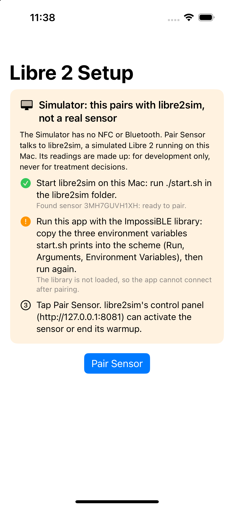
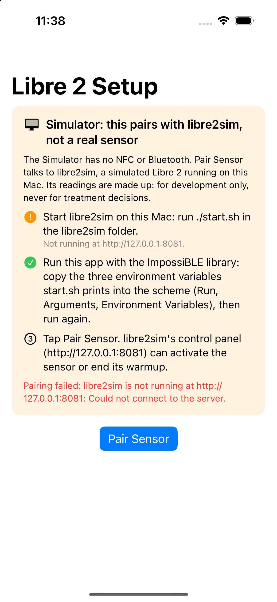

# Pair with libre2sim in the iOS Simulator

## What

Libre 2 pairing in the iOS Simulator, against libre2sim, an emulator of a Libre 2 sensor for
development. Made against `next-dev` (it also applies to `main`). Everything new is in two new files; the edits to existing
files are small and inert on a device:

- **New:** `LibreSensor/SensorPairing/SimulatedSensorPairingService.swift`, entirely inside `#if targetEnvironment(simulator)`.
  A `SensorPairingProtocol` that asks libre2sim's HTTP API the questions `SensorPairingService` asks over CoreNFC (tag
  identifier, system info, patch info `A1`, 43 blocks of FRAM in requests of 3, then enable streaming), in the same order, and
  puts the answers through the same checks. It reads `LIBRE2SIM_URL`, default `http://127.0.0.1:8081`. Registered in the
  `LibreTransmitter` target next to `SensorPairingService.swift` (the notice in `LibreTransmitterUI`, next to
  `Libre2DirectSetup.swift`).
- `SensorPairingService.swift`: `nfcCommand` goes from `private` to `fileprivate`, and a Simulator-only extension at the end of
  the file, `SensorPairingService.enableStreamingCommand(…)`, hands the new file the command bytes from that same function, so
  the Simulator and CoreNFC paths cannot drift apart.
- **New:** `LibreTransmitterUI/Views/Setup/SimulatorPairingNotice.swift`, entirely inside `#if targetEnvironment(simulator)`,
  shown by `Libre2DirectSetup` (3 lines, also Simulator-only). It says that in the Simulator pairing needs libre2sim rather
  than a sensor, lists the steps (start libre2sim, run with the ImpossiBLE library, pair), checks each one it can every few
  seconds (libre2sim reachable and its sensor's state, the library loaded), and shows why a pairing failed, which the setup
  screen otherwise only reports to the console. Its strings are `Text(verbatim:)`: developer-only, not for the catalog.

  | libre2sim running, library not loaded | libre2sim stopped, library loaded, pairing failed |
  |---|---|
  |  |  |

- `LibreTransmitterManagerV3.pairingService` returns the simulated service on the Simulator.
- `Features.phoneNFCAvailable` is `true` on the Simulator, so the pairing UI offers a scan.

## Why

The Simulator has no NFC and no Bluetooth, so the Libre 2 direct path could not be exercised without a phone and a live sensor. With
[ImpossiBLE](https://github.com/mickeyl/ImpossiBLE) providing CoreBluetooth in the Simulator (the way
[libre3sim](https://github.com/LoopKit/libre3sim) and g7sim do for other sensors) and this service providing NFC, the whole path
from pairing to glucose readings runs in the Simulator: UID, patch info and FRAM, the streaming unlock, scanning for the
advertised name, the 46-byte packets, and the glucose algorithm. That makes the reconnect, out-of-range, expiry and bad-packet cases
repeatable, and lets a change to this code be tested without a sensor.

## Behaviour on a device is unchanged

- Everything new is behind `#if targetEnvironment(simulator)`. The one edit outside it, `private` → `fileprivate` on
  `nfcCommand`, does not change what the function does.
- The sources typecheck for both the Simulator and device targets, and a device build cannot see `SimulatedSensorPairingService`.
- A device build compiles to the same code: resolving `#if targetEnvironment(simulator)` leaves only the `fileprivate` change, and
  the pairing code compiled for arm64 iOS (`-O`, whole module) with and without this patch differs only in `__swift_modhash`, the
  16-byte hash of the source text. Machine code, data and symbols are identical. (libre2sim's `tools/devicecheck`.)

## How it was tested

Against libre2sim at its current state, which was itself checked against the Swift in this repository (`main` @ `4110512`; the
files it ports are the same on `next-dev`):

- The libre2sim Go port of `PreLibre2`, the FRAM CRCs and the BLE packet cipher reproduces golden vectors printed by this
  repository's own Swift (`tools/swiftvectors`, copies of `PreLibre2.swift` and `CRC.swift`), byte for byte.
- `tools/pairharness`: this repository's real pairing code (`next-dev`), with this patch applied, built as an iOS Simulator binary, pairs with a
  live libre2sim: the FRAM CRCs are valid, the state is "ready", the sensor age is right, the MAC equals the advertised name, and the
  FRAM trend decodes through `GlucoseFromRaw` to the value libre2sim modelled.
- `tools/bleharness` and `tools/cbharness`: real CoreBluetooth with the ImpossiBLE library, driving this repository's real
  `Libre2DirectTransmitter`: scan for FDE3, match `name == MAC` and `canSupportPeripheral`, connect, discover F001 and F002, the plugin's
  own unlock write, then packets reassembled from 20 + 20 + 6 bytes, with a valid CRC and a glucose value equal to the model.
- `tools/cbharness` also ran libre2sim's scenarios for reconnecting, out of range, low glucose, end of wear and a new sensor.
- `tools/noticeharness`: a minimal Simulator app (no App Transport Security exceptions, like Loop) showing the notice above a
  Pair Sensor button wired to the real service; the screenshots above are from it. `Libre2DirectSetup` itself needs LoopKitUI and
  was not compiled outside a full build: its change is the 3-line `#if` block.
- Not yet run: a full Loop build in the Simulator. See the scenarios in libre2sim's `docs/scenarios.md`.

## Notes

- Two quirks found on the way that this PR does not touch: `parseBLEData` stamps trend record *i* at `now − i` minutes, which is wrong for
  records 1 to 6, and the receive buffer in `Libre2DirectTransmitter` is parsed only at exactly 46 bytes, so one short packet
  leaves it stale until a reset. I will open a separate issue for the first.
- libre2sim's disclaimer: it is a development tool, not an Abbott product, and its data is simulated.

🤖 Generated with [Claude Code](https://claude.com/claude-code)
